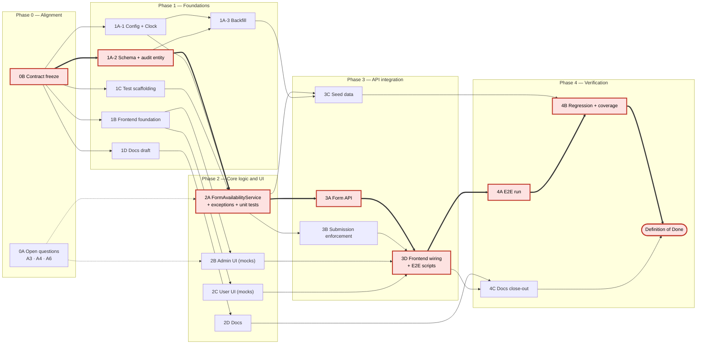

# Implementation Plan — Form Availability (Manual Close + Start/End Dates)

Related: [ImpactAnalysis.md](ImpactAnalysis.md) (impact analysis and the clarifying questions Q1–Q18 referenced below).

## 1. Summary

Admins can control when a form accepts submissions in two ways:

1. **Manual control (primary, Q1):** a **Close now** action and a **Reopen** action on each form.
2. **Availability dates (Q1, Q2):** every form has a start date and an end date (whole days). A form opens at **00:00** on its start date and closes at **17:00** on its end date, **Helsinki time**. If the admin leaves a date empty, defaults apply: start = today, end = start + 10 years.

Outside the window, or while manually closed, regular users cannot submit new submissions or edit existing ones. Admins can still do both. Logged-in users see each form's status and dates. A warning is shown on the submission page when the deadline is near. Unauthenticated callers see no availability information.

---

## 2. Design Decisions

| # | Decision | Source |
|---|---|---|
| D1 | Manual **Close now** / **Reopen** is the primary mechanism. Dates are an addition on top of it. | Q1 |
| D2 | Both dates are optional on input but **always stored**. Missing start → today (Helsinki). Missing end → start + 10 years. Existing forms are backfilled as start = `created_at` date, end = start + 10 years. | Q2 |
| D3 | Dates are whole days (`DATE`). The form opens at **00:00** on the start date and closes at **17:00** on the end date. The end is exclusive: a submission received at 17:00:00 or later is rejected. | Q3, *assumption A1* |
| D4 | All rules are evaluated in **Europe/Helsinki** using the server clock. Daylight saving time is handled by `ZoneId`. The timezone is **not** shown in the UI. Timezone, closing time, default lifespan and warning threshold are configuration properties. | Q4 |
| D5 | Status is computed on the server: `UPCOMING`, `OPEN` or `CLOSED`. Manual close takes precedence over the dates. The browser clock is never used to decide whether a submission is allowed. | Q4, Q5 |
| D6 | Out-of-window submissions get a **409 Conflict** with a machine-readable code (`FORM_NOT_YET_OPEN` / `FORM_CLOSED`). The frontend shows a translated, clear message and **keeps the user's typed input** in the form. | Q5 |
| D7 | The submission page always shows the form's dates. A **deadline warning** banner appears when the deadline is less than 24 hours away (configurable). The warning is in-app only. | Q6, Q9, Q15, *assumption A2* |
| D8 | Closed and upcoming forms are **listed with a status badge**. They are not hidden. | Q7 |
| D9 | Editing existing submissions is **locked** for regular users whenever the form is not `OPEN`. The same rule applies to a deleted form. Viewing is always allowed. | Q8 |
| D10 | Status and dates are returned only by **authenticated** endpoints. The public `GET /api/forms` stays unchanged (`formKey`, `title`). | Q9, Q10 |
| D11 | **Admins bypass** the window and manual close for both submitting and editing. The UI shows them an "outside availability window" notice. The bypass is decided from `ROLE_ADMIN` on the server. | Q11 |
| D12 | **Editing dates must not change the form's current status.** Status changes happen only through explicit **Close now** / **Reopen** actions. See §3.4 for the exact rules. | Q12 |
| D13 | A **newly set or changed** end date must not be in the past: its 17:00 deadline must be later than now. To close a form immediately, the admin uses **Close now**. | Q13 |
| D14 | Every availability change (dates, close, reopen) is written to an **audit log** with who, when, old value and new value. Admins can see the log in the form editor. | Q12 |
| D15 | Seed JSON forms support optional `availableFrom` / `availableUntil`, with the same defaults. The initializer **never overwrites** an existing form. | Q14 |
| D16 | Out of scope: notifications outside the app, recurring schedules, submission limits, and any change to existing submissions when a form closes. | Q15, Q16, Q17 (no answer), Q18 |

### 2.1 Status Computation (server)

```
opensAt  = availableFrom  at 00:00 Europe/Helsinki
closesAt = availableUntil at 17:00 Europe/Helsinki

if manuallyClosed            -> CLOSED
else if now <  opensAt       -> UPCOMING
else if now >= closesAt      -> CLOSED
else                         -> OPEN
```

---

## 3. Database Changes

### 3.1 `form` table — new columns

| Column | Type | Notes |
|---|---|---|
| `available_from` | `DATE` | Always populated by the service. Nullable at DB level because of `ddl-auto: update`. Not-null is enforced in the entity. |
| `available_until` | `DATE` | Same as above. |
| `manually_closed` | `BOOLEAN NOT NULL DEFAULT FALSE` | |
| `closed_at` | `TIMESTAMP WITH TIME ZONE` | Set by Close now. Cleared by Reopen. |
| `closed_by` | `VARCHAR(255)` | Username from the JWT. |

### 3.2 New table `form_availability_audit`

```sql
CREATE TABLE form_availability_audit (
    id BIGSERIAL PRIMARY KEY,
    form_key VARCHAR(255) NOT NULL,
    action VARCHAR(32) NOT NULL,        -- DATES_CHANGED | CLOSED | REOPENED | CREATED
    old_available_from DATE,
    old_available_until DATE,
    new_available_from DATE,
    new_available_until DATE,
    changed_by VARCHAR(255) NOT NULL,
    changed_at TIMESTAMP WITH TIME ZONE NOT NULL
);
```

Audit rows are kept when a form is deleted, consistent with how submissions are kept.

### 3.3 Backfill of existing forms

An idempotent startup step sets the defaults for any rows where the dates are `NULL`: `available_from = created_at::date` (Helsinki), `available_until = + 10 years`. It runs before `DatabaseInitializer` loads seeds.

*Optional:* introduce Flyway now, since this is the first schema change that needs a data backfill. This is not required for the feature.

### 3.4 Date-edit rules (enforced in `FormService`, mirrored in the frontend)

Let **S** be the status computed from the stored values, and **S′** the status computed from the new values at the same `now`.

| Current status S | Allowed date edits |
|---|---|
| `OPEN` | Start date ≤ today. The new end deadline must be after now (D13). In short: S′ = `OPEN`. |
| `UPCOMING` | Start date > today. End date ≥ start date. In short: S′ = `UPCOMING`. |
| `CLOSED` by date | Dates are locked. To reopen, use **Reopen** (§5.2), which requires a new future end date. |
| `CLOSED` manually | Dates may be edited (status stays `CLOSED` because of the flag). A changed end date must be in the future. |
| *(create)* | Any start date, including past dates. End deadline must be in the future. End date ≥ start date. |

General rules:
- `availableUntil ≥ availableFrom` always.
- An **unchanged** past end date is accepted. This lets an admin edit the title or fields of a closed form.

---

## 4. Backend Changes

| Component | Change |
|---|---|
| `config/FormAvailabilityProperties` (new) | `app.forms.availability.timezone=Europe/Helsinki`, `closing-time=17:00`, `opening-time=00:00`, `default-lifespan=P10Y`, `deadline-warning=PT24H`. |
| `config/ClockConfig` (new) | `Clock` bean in the configured zone. Every time comparison uses it, which makes the logic testable. |
| `entity/Form` | New fields from §3.1. |
| `entity/FormAvailabilityAudit` + repository (new) | §3.2. |
| `service/FormAvailabilityService` (new) | `computeStatus(form)`, `opensAt` / `closesAt`, `assertCanSubmit(form, auth)`, `assertCanEditSubmission(form, auth)`, `validateDateChange(old, new)`, `close(key, user)`, `reopen(key, newUntil?, user)`, audit writes. All availability logic lives here. |
| `service/FormService` | Apply the default dates on create and update. Call `validateDateChange`. Write an audit entry when the dates change. |
| `service/FormDataService` | On submit: `assertCanSubmit` (admin bypass). On update: look up the form by the submission's `formKey`, then `assertCanEditSubmission`. A deleted form counts as `CLOSED` for non-admins. |
| `dto/*` | Request DTOs get `availableFrom` and `availableUntil` (`LocalDate`, optional). Response DTOs for authenticated endpoints get an `availability` object (§5.3). The public list DTO is unchanged. |
| `mapper/*` | Map the new fields. `availability.status` and the instants are computed by the service, not by MapStruct. |
| Exceptions + `@RestControllerAdvice` | New `FormNotAvailableException(code, opensAt, closesAt)` → **409** with an error body. Date-rule violations return **400** with codes: `END_BEFORE_START`, `END_IN_PAST`, `STATUS_CHANGE_NOT_ALLOWED`, `DATES_LOCKED_WHILE_CLOSED`. |
| `controller/FormController` | New admin endpoints: close, reopen and audit (§5.2). |
| `config/SecurityConfig` | Add the new admin endpoints to the `ROLE_ADMIN` rules. |
| `config/DatabaseInitializer` + `resources/forms/*.json` | Accept the optional date fields and apply the defaults. Insert only if the key does not exist (verify the current behaviour). Run the backfill (§3.3) first. |
| Logging | Log rejected out-of-window attempts at INFO with the form key and username, without the submission data. |

---

## 5. API Changes

### 5.1 Changed endpoints

| Endpoint | Change |
|---|---|
| `POST /api/forms`, `PUT /api/forms/{key}` | Body accepts optional `availableFrom` and `availableUntil` (`YYYY-MM-DD`). Returns `400` with an error code when the rules in §3.4 are violated. |
| `GET /api/forms/{key}`, `GET /api/forms/all` | Response includes `availability` (§5.3). |
| `GET /api/forms` (public) | **Unchanged.** Does not expose availability (D10). |
| `POST /api/form-data/{key}` | `409` with `FORM_NOT_YET_OPEN` or `FORM_CLOSED` for non-admins outside the window. |
| `PUT /api/form-data/submission/{id}` | `409 FORM_CLOSED` for non-admins when the form is not `OPEN`. |

### 5.2 New endpoints (ROLE_ADMIN)

| Endpoint | Behaviour |
|---|---|
| `POST /api/forms/{key}/close` | Sets `manuallyClosed`, `closedAt` and `closedBy`, and writes an audit entry. Returns the updated form. Calling it on a form that is already closed has no further effect. |
| `POST /api/forms/{key}/reopen` | Body `{ "availableUntil": "YYYY-MM-DD" }`, optional. Clears the manual close. If the dates alone would leave the form `CLOSED`, a new future `availableUntil` is **required** (otherwise `400 DATES_LOCKED_WHILE_CLOSED`). Writes an audit entry. |
| `GET /api/forms/{key}/availability-history` | Audit entries for the form, newest first. |

### 5.3 `availability` object

```json
"availability": {
  "availableFrom": "2026-12-01",
  "availableUntil": "2026-12-31",
  "opensAt": "2026-12-01T00:00:00+02:00",
  "closesAt": "2026-12-31T17:00:00+02:00",
  "status": "UPCOMING",
  "manuallyClosed": false,
  "closedAt": null,
  "closedBy": null,
  "serverTime": "2026-11-12T10:15:00+02:00"
}
```

`serverTime` lets the frontend show an accurate deadline warning even when the user's device clock is wrong.

### 5.4 Error body (409 example)

```json
{ "code": "FORM_CLOSED", "closesAt": "2026-12-31T17:00:00+02:00" }
```

---

## 6. Frontend Changes

| Component | Change |
|---|---|
| `types/Form.ts` | Add `FormAvailability` and `FormStatus` types; add `availability` to `Form`. |
| `utils/availability.ts` (new) | Format dates with `Intl.DateTimeFormat` (`timeZone: 'Europe/Helsinki'`, current i18n locale). Implement `isDeadlineNear(availability)` using the offset between `serverTime` and the browser clock. |
| `components/common/AvailabilityBadge.tsx` (new) | Status badge: Open / Opens {date} / Closed. |
| `components/common/AvailabilityInfo.tsx` (new) | Shows "Open {from} – {until} 17:00" plus the deadline warning banner (D7). |
| Routing (`Content.tsx`) | Add the missing `/forms/:formKey/edit` → `EditForm` route (UC-10 has no route today). |
| `pages/EditForm.tsx` | Two `date` inputs prefilled with the defaults. Inputs are disabled or limited according to §3.4 for the current status. Zod rules mirror the server. **Close now** / **Reopen** buttons with an in-page confirmation; Reopen asks for a new end date when one is required. Shows the availability history. Maps server error codes to translated field errors. |
| `pages/Forms.tsx` | Switch to the authenticated `GET /api/forms/all` to get availability. Show the badge and dates on each form. For users, closed and upcoming forms are shown but not clickable; admins can still open them. Admins get Edit / Close / Reopen shortcuts. |
| `pages/FormSubmission.tsx` (new submission) | Show `AvailabilityInfo`. If the form is not `OPEN`: users see a clear "not yet open" or "closed" message instead of the form; admins see the form with an "outside availability window" notice. On a `409` response, show the translated message and **do not reset the form**. Refresh the availability data. |
| `pages/FormSubmission.tsx` (edit mode) | Same rules. Users get a "submissions are locked because the form has closed" message. |
| `pages/FormSubmissions.tsx` | Look up form status from the `['forms']` query. Hide **Edit** for users when the form is not `OPEN`. Show a lock indicator. |
| `services/formClient.ts` | Add `closeForm`, `reopenForm`, `getAvailabilityHistory`. Parse the error `code` from `409` and `400` responses. |
| React Query | Invalidate `['forms']` and `['form', key]` after edit, close or reopen. Use a short `staleTime` and `refetchOnWindowFocus` for form queries. The UI state is a hint only; the server decides. |
| `public/locales/*/translation.json` | New keys under `availability.*` (statuses, banners, warning, error codes, editor labels, close/reopen confirmations). |

---

## 7. Testing Plan

### 7.1 Backend unit tests (fixed `Clock`, Europe/Helsinki)

- **Status boundaries:** one second before 00:00 on the start date → `UPCOMING`. 00:00 → `OPEN`. 16:59:59 on the end date → `OPEN`. 17:00:00 → `CLOSED`. A start date equal to the end date gives a window of 00:00–17:00.
- **Daylight saving time:** a window that crosses the DST change in March or October keeps its 00:00 / 17:00 local times.
- **Manual close** overrides an `OPEN` date window. **Reopen** with and without a new end date.
- **Defaults:** missing start → today; missing end → start + 10 years; leap day (29 Feb + 10 years).
- **Date-edit rules (§3.4):** every row in the table, both the allowed and the rejected cases, including an unchanged past end date on a closed form.
- **Submit / edit checks:** a user is rejected with the correct code; an admin bypasses; a deleted form is treated as closed for edits.
- **Audit entries** are written for create, date change, close and reopen.
- **Backfill** is idempotent. **Initializer** handles seeds with and without dates and does not overwrite existing forms.

### 7.2 Backend integration tests (MockMvc + Testcontainers PostgreSQL)

- API contract: the `availability` object; the public `GET /api/forms` does **not** expose it.
- Status codes and error bodies: `409` on submit and edit, `400` date-rule codes, `403` for non-admin close, reopen and history calls.
- `DATE` and `TIMESTAMP WITH TIME ZONE` round-trip correctly on both PostgreSQL and H2.

### 7.3 Frontend unit tests (vitest + Testing Library)

- `availability.ts`: formatting in Helsinki time for several locales; `isDeadlineNear` with a mocked browser clock that is skewed from `serverTime`.
- `EditForm`: defaults are prefilled, inputs are disabled or limited per status, Zod errors appear, server error codes are mapped, and the Close / Reopen flows work.
- `Forms`: badges render; closed cards are not clickable for users but are for admins.
- `FormSubmission`: closed and upcoming messages; admin notice; deadline banner; a `409` keeps the entered values.
- `FormSubmissions`: Edit is hidden for users on closed forms and visible for admins.

### 7.4 End-to-end tests (Selenium)

- An admin creates a form with future dates; a user sees "Opens …" and cannot submit.
- An admin clicks **Close now** while a user has the form open; the user submits and gets a clear error with their input intact.
- An admin reopens the form with a new end date; the user can submit again.
- A user cannot edit a submission after the form closes; an admin can.

### 7.5 Regression

- Existing forms (after backfill) and every existing use case (UC-01 to UC-12) behave as before while the form is `OPEN`.
- Coverage of the new code is above 70% (Req §4.4).

---

## 8. Documentation Updates

- **RequirementsSpecification.md:** §3.2 (availability dates, Close/Reopen, audit), §3.3 (submission and edit restrictions, admin bypass), §3.4 (status display, deadline warning).
- **UseCases.md:**
  - UC-03: status badges.
  - UC-04 and UC-07: new alternative flows for "form not open" and admin override.
  - UC-09 and UC-10: date fields and edit rules.
  - New use cases: **UC-13 Close a Form**, **UC-14 Reopen a Form**, **UC-15 View Availability History**.
  - Fix the authentication note on `GET /api/forms` in UC-03.
- **TechnicalSpecification.md:**
  - §3.4: new route and components.
  - §4.1: schema changes and the audit table.
  - §5: endpoints, the `availability` object and error codes.
  - §6.2: new admin endpoints.
  - §7: new configuration properties.
  - §9.2: `availability.*` translation keys.

---

## 9. Implementation Phases

The work is split into five phases. Each phase has entry and exit criteria, and its work is split into **tracks** that can run at the same time. Tracks in the same phase do not edit the same files (see §9.5), so they can be developed on separate branches and merged independently.

The frontend is not blocked by the backend: once the API contract (§5) is frozen in Phase 0, the frontend is built against mocked responses and connected to the real API in Phase 3.

★ marks tasks on the **critical path**. A delay in a ★ task delays the whole feature.

### 9.1 Phase Overview

| Phase | Goal | Tracks | Exit gate (summary) |
|---|---|---|---|
| **0. Alignment and contract freeze** | Settle open scope questions and freeze the API contract so that backend and frontend can work in parallel. | 0A, 0B | Contract frozen; scope-affecting questions answered. |
| **1. Foundations** | Time handling, schema, frontend building blocks, test helpers. | 1A ★, 1B, 1C, 1D | Schema runs on H2 and PostgreSQL; frontend foundation merged. |
| **2. Core logic and UI build** | All availability rules in one service; admin and user screens against mocks. | 2A ★, 2B, 2C, 2D | §7.1 unit tests pass; screens complete against mocks. |
| **3. API integration** | Expose the rules through the API; connect the frontend to the real backend. | 3A ★, 3B, 3C, 3D ★ | §7.2 integration tests pass; frontend uses no mocks. |
| **4. Verification and close-out** | E2E, regression, coverage, final documentation. | 4A ★, 4B ★, 4C | Definition of Done (§9.2, Phase 4). |

### 9.2 Phase Details

#### Phase 0 — Alignment and contract freeze

**Entry criteria**
- [ImpactAnalysis.md](ImpactAnalysis.md) and this plan have been reviewed by the team.

| Track | Owner | Tasks |
|---|---|---|
| **0A** Open questions | Product owner | Get answers to the **scope-affecting** assumptions: A3 (reopen an expired form), A4 (Open now action), A6 (history UI). A1, A2, A5 and A8 are configuration values or defaults; work proceeds with the stated assumption and they can change later without blocking anyone. |
| **0B** Contract freeze | Tech lead, backend, frontend | Freeze the request and response shapes in §5, the full list of error codes (§4, §5), and the names of the `availability.*` translation keys. Decide whether to introduce Flyway (§3.3). Agree on file ownership (§9.5). |

**Exit criteria**
- §5 is marked frozen. Later changes to it need the tech lead's approval and must be announced to both backend and frontend.
- A3, A4 and A6 are answered, or the team explicitly accepts the assumption. If A4 adds an **Open now** action, add it to tracks 2A, 3A and 2B before Phase 1 ends.
- The Flyway decision is recorded.

#### Phase 1 — Foundations

**Entry criteria**
- Phase 0 exit criteria are met.

| Track | Owner | Tasks | Depends on |
|---|---|---|---|
| **1A** Time and schema ★ | Backend | 1A-1 `FormAvailabilityProperties` and `ClockConfig`. 1A-2 New `Form` fields, `FormAvailabilityAudit` entity and repository. 1A-3 Backfill step (§3.3). 1A-1 and 1A-2 can be done in parallel; 1A-3 needs both. | 0B |
| **1B** Frontend foundation | Frontend | `types/Form.ts`; `utils/availability.ts` with its unit tests; `AvailabilityBadge` and `AvailabilityInfo`; **all** `availability.*` translation keys; **all** new `formClient` methods and error-code parsing; mocked API responses that follow the frozen contract; the missing `/forms/:formKey/edit` route. | 0B |
| **1C** Test scaffolding | QA / backend | Fixed-`Clock` test helper for Europe/Helsinki; Testcontainers PostgreSQL base setup; E2E fixtures (admin and user accounts, helper to create a form with given dates). | 0B |
| **1D** Documentation draft | Any | Draft the §8 changes that follow from the frozen contract: new use cases UC-13 to UC-15, endpoints and error codes in TechnicalSpecification §5 and §6.2, configuration in §7, translation keys in §9.2. | 0B |

**Exit criteria**
- The application starts on H2 and on PostgreSQL with the new columns and audit table. Existing forms are backfilled, and running the backfill twice changes nothing.
- All existing backend and frontend tests still pass.
- The frontend foundation is merged, and the `availability.ts` unit tests (§7.3) pass.
- The fixed-`Clock` helper and the Testcontainers setup are merged.

#### Phase 2 — Core logic and UI build

**Entry criteria**
- Track 2A: 1A-1 and 1A-2 are merged.
- Tracks 2B and 2C: 1B is merged.
- 2A and 2B do not have to start on the same day. Each track starts as soon as its own dependencies are met.

| Track | Owner | Tasks | Depends on |
|---|---|---|---|
| **2A** `FormAvailabilityService` ★ | Backend | Status computation, `opensAt` / `closesAt`, defaults, `validateDateChange`, `assertCanSubmit`, `assertCanEditSubmission`, `close`, `reopen`, audit writes. Also the exception classes and their `@RestControllerAdvice` mapping, so Phase 3 tracks only use them. Unit tests §7.1, except the initializer tests. Two developers can split this work once the method signatures are agreed: **2A-1** status, defaults, submit and edit checks; **2A-2** date-edit rules, close, reopen, audit. | 1A-1, 1A-2, 1C, 0A (A3) |
| **2B** Admin UI | Frontend | `EditForm`: date inputs with defaults, limits per status (§3.4), Zod rules, Close now / Reopen with confirmation, history panel, server error-code mapping. Unit tests §7.3 for `EditForm`. Built against mocks. | 1B, 0A (A4, A6) |
| **2C** User UI | Frontend | `Forms` list (switch to `GET /api/forms/all`, badges, clickable rules, admin shortcuts); `FormSubmission` new and edit modes, including the "keep input on 409" behaviour; `FormSubmissions` Edit lock; deadline banner; React Query invalidation and `staleTime`. Unit tests §7.3 for these pages. Built against mocks. | 1B |
| **2D** Documentation | Any | Continue §8: Requirements §3.2–§3.4 and the alternative flows in UC-03, UC-04, UC-07, UC-09 and UC-10. | 1D |

**Exit criteria**
- All §7.1 unit tests pass, including every row of the §3.4 table, the 00:00 / 17:00 boundaries, and the DST cases.
- The admin and user screens are complete against mocks, and their §7.3 unit tests pass.
- The frontend calls only endpoints and fields that exist in the frozen contract.

#### Phase 3 — API integration

**Entry criteria**
- 2A is merged (required by 3A, 3B and 3C).
- 3D can start as soon as the first 3A endpoint is merged. It needs 2B and 2C to be merged.

| Track | Owner | Tasks | Depends on |
|---|---|---|---|
| **3A** Form API ★ | Backend | DTOs and mappers; `FormService` defaults, validation and audit entries; close, reopen and history endpoints in `FormController`; `SecurityConfig` rules. Integration tests §7.2 for these endpoints, including the check that the public `GET /api/forms` is unchanged. | 2A |
| **3B** Submission enforcement | Backend | `FormDataService` checks on submit and edit; a deleted form counts as closed; INFO logging of rejected attempts. Integration tests §7.2 for the `409` responses. | 2A |
| **3C** Seed data | Backend | `DatabaseInitializer` and `resources/forms/*.json`: optional date fields, defaults, insert-only behaviour, backfill runs first. Initializer tests from §7.1. | 2A, 1A-3 |
| **3D** Frontend wiring and E2E scripts ★ | Frontend, QA | Switch the screens from mocks to the real endpoints as 3A and 3B land, and fix any differences from the contract. QA writes the §7.4 E2E scripts against a development environment. | 2B, 2C, first 3A endpoint; finishes after 3A and 3B |

**Exit criteria**
- All §7.2 integration tests pass on PostgreSQL and H2.
- The public `GET /api/forms` response is verified unchanged.
- The frontend runs against the real backend without mocks; all frontend unit tests pass.
- The §7.4 E2E scripts are written and run locally.

#### Phase 4 — Verification and close-out

**Entry criteria**
- Phase 3 exit criteria are met, and the feature is deployed to a test environment.

| Track | Owner | Tasks |
|---|---|---|
| **4A** E2E ★ | QA (developers fix defects) | Run the §7.4 scenarios in the test environment. Fix defects. |
| **4B** Regression and coverage ★ | QA, backend, frontend | §7.5: UC-01 to UC-12 on backfilled data; coverage of new code above 70%. 4B can start in parallel with 4A, but its final pass runs after the last 4A fix. |
| **4C** Documentation close-out | Any | Align the §8 documents with the delivered behaviour. Record the final answer to each item in §10. |

**Exit criteria (Definition of Done)**
- All unit, integration and E2E tests pass, and coverage of new code is above 70%.
- The documentation changes (§8) are merged.
- Each item in §10 is confirmed or explicitly accepted.
- The product owner has seen a demo and accepts the feature.

### 9.3 Concurrency Map

Thick arrows (`==>`) and red nodes are the critical path. Thin arrows are dependencies with slack. Dotted arrows are soft dependencies (the task can start, but needs the input before it finishes).



**Critical path:** 0B Contract freeze → 1A-2 Schema → 2A `FormAvailabilityService` → 3A Form API → 3D Frontend wiring → 4A E2E → 4B Regression → Done.

**Why these tasks:** every backend feature needs the service (2A), and the service needs the schema (1A-2). 3A is the largest Phase 3 backend track, so it finishes after 3B and 3C. E2E needs the whole stack.

**Where there is slack:**
- **Frontend tracks 1B, 2B and 2C** have slack until 3A is ready, because they use mocks. If they are late, they move onto the critical path.
- **3B and 3C** are smaller than 3A and run alongside it.
- **Documentation (1D, 2D, 4C)** has the most slack. It only has to be finished before Done.

**How to shorten the critical path:**
- Freeze the contract (0B) as early as possible. It is the only thing that blocks every track.
- Split 2A between two developers (2A-1 and 2A-2) once the method signatures are agreed.
- Merge 3A endpoint by endpoint, so that 3D can start wiring before 3A is complete.
- Start 4B regression runs during 4A, and keep only the final pass after the last fix.

### 9.4 Example Track Allocation

The table shows one way to staff the tracks with two backend developers, two frontend developers and one QA engineer. With a smaller team, the tracks within a phase run one after another, but the phase order and gates stay the same.

| Person | Phase 0 | Phase 1 | Phase 2 | Phase 3 | Phase 4 |
|---|---|---|---|---|---|
| Backend 1 | 0B | 1A ★ | 2A-1 ★ | 3A ★ | 4A/4B fixes |
| Backend 2 | 0B | 1C | 2A-2 ★ | 3B, then 3C | 4B |
| Frontend 1 | 0B | 1B | 2B | 3D ★ | 4A/4B fixes |
| Frontend 2 | — | 1B | 2C | 3D ★ | 4B |
| QA | — | 1C (E2E fixtures) | Test-case design for §7.4 | 3D (E2E scripts) | 4A ★, 4B ★ |
| Product owner / tech lead | 0A, 0B | 1D | 2D | Contract-change approvals | 4C, demo |

### 9.5 Shared Files and Ownership

These files are touched by more than one part of the feature. Each has one owning track, so that parallel tracks do not cause merge conflicts.

| File | Owning track | Rule for other tracks |
|---|---|---|
| `entity/Form` | 1A | No changes after Phase 1. |
| Exception classes, `@RestControllerAdvice` | 2A | 3A and 3B use them but do not change them. |
| `service/FormService` / `service/FormDataService` | 3A / 3B | Separate files, so 3A and 3B can run in parallel. |
| `config/SecurityConfig` | 3A | No other track changes it. |
| `types/Form.ts`, `services/formClient.ts` | 1B | 1B adds all new types and methods up front. Later tracks only fix bugs in them. |
| `public/locales/*/translation.json` | 1B | 1B adds every `availability.*` key from the frozen list. Later tracks change only the text. |
| `pages/FormSubmission.tsx` | 2C | 2B does not change it. |
| `Content.tsx` (routing) | 1B | No other track changes it. |

---

## 10. Assumptions and Open Questions

These points were not fully settled by the customer's answers. The plan proceeds with the stated assumption, but each should be confirmed.

| # | Topic | Assumption in this plan | Question to confirm |
|---|---|---|---|
| A1 | Opening time | A form opens at **00:00** on the start date. Only the closing time (17:00) was specified. | Should forms open at 00:00, or at the start of the shift (e.g. 08:00)? |
| A2 | "Deadline near" threshold | Warning shown when less than **24 h** remain (configurable). | Is 24 hours right? |
| A3 | Reopening a date-expired form | Allowed via explicit **Reopen** with a new end date. Date edits alone cannot reopen it (Q12 answer). | Confirm that admins should be able to reopen a form whose end date has passed. |
| A4 | Moving an upcoming form's start to today | Not allowed through date editing, because it would change the status (Q12). There is no "Open now" action. | Is an **Open now** action needed for upcoming forms, alongside Close now? |
| A5 | 10-year default | Counted from the start date (from `created_at` for existing forms). | Confirm. |
| A6 | Audit history visibility | Shown to admins in the form editor. | Is storing it enough, or is a UI view wanted? |
| A7 | Submission limits | Out of scope (Q17 was not answered). | Confirm that no maximum submission count or one-per-person limit is needed. |
| A8 | Weekends and holidays | The 17:00 deadline applies on any calendar day. | Should an end date that falls on a weekend or holiday be handled differently? |
